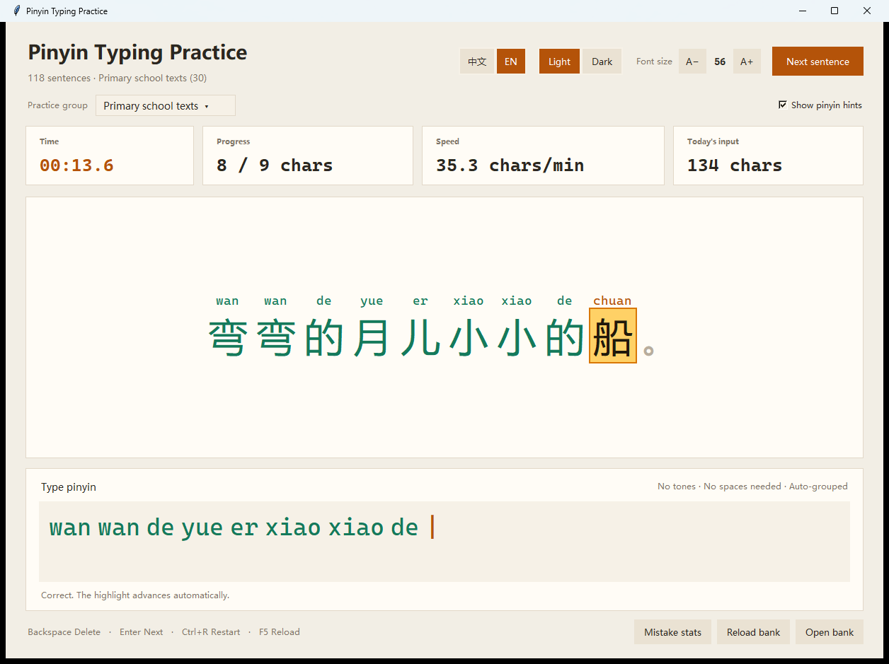
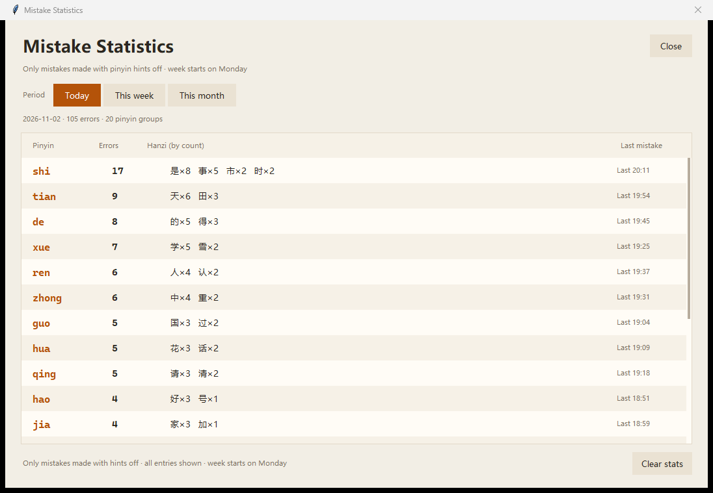

# 拼音打字练习 / Pinyin Typing Practice

一个用 Python + Tkinter 编写的整句拼音打字练习工具。上方显示中文句子，当前正在输入的字会高亮；下方输入整句拼音，完成后自动显示用时和速度。支持中英文界面、分组练习、可选拼音提示、错字统计、每日输入计数、亮色/暗色主题和可调字号。

| 中文亮色 | 中文暗色（拼音提示） | English UI |
|---|---|---|
|  |  |  |

| 中文错字统计 | English statistics |
|---|---|
|  |  |

## 功能

- 整句连续输入拼音，不需要逐字回车。
- **不用输入空格**；输入区会按目标字音自动分字，在拼音之间留出小间距。
- 当前字高亮，已完成的字变绿，标点自动跳过。
- 输错时输入框变红，按 Backspace 修改即可。
- 第一次输入字母时开始计时，整句完成时停止。
- 实时显示进度和速度（字/分），完成后按 Enter 进入下一句。
- 练习分组下拉框，可只练某一个分组，也可以练全部分组。
- 可选“显示拼音提示”，在汉字上方显示正确拼音。
- 中英文界面一键切换，语言、主题、字号和分组都会保存。
- 未开启拼音提示时自动记录打错的汉字、目标拼音和时间；统计窗口用三个按钮切换今天、本周、本月，按拼音汇总错误次数和对应汉字。
- 顶部“今日输入”卡片显示今天已经正确完成输入的汉字拼音个数；每日数量会保存到本地。
- 118 句内置练习，覆盖日常生活、自然、学习工作、旅行美食、成语诗词、绕口令、生活感悟和小学语文课文。
- 亮色 / 暗色两种配色，设置会自动保存。
- 字号可在 32–96 之间调整，默认 56；句子过长时句子区可滚动，不挤压输入区。
- 拼音按词组上下文生成，能正确处理“银行、音乐、重庆、山重水复”等多音字。
- 可打包成单个 Windows EXE。

## 运行环境

本项目使用本机 `C:\py` 下的 Python 环境：

```text
C:\py\.pixi\envs\default\python.exe
Python 3.14.7
Tk 8.6
pypinyin 0.55.0
```

`pypinyin` 和打包工具已经装入 `C:\py` 环境。若需要重新安装：

```powershell
cd C:\py
pixi add pypinyin
pixi add pyinstaller
```

## 启动

双击项目根目录的 `run.bat` 即可启动（无控制台窗口）。

调试时使用 `run-debug.bat`，可以查看 Python 控制台错误。

也可以直接运行：

```powershell
& "C:\py\.pixi\envs\default\python.exe" .\main.py
```

## 打包成单个 EXE

双击 `build_exe.bat`，或在项目目录执行：

```powershell
& "C:\py\.pixi\envs\default\python.exe" -m PyInstaller --noconfirm --clean PinyinTrainer.spec
```

输出文件：

```text
dist\PinyinTrainer.exe
```

说明：

- 使用 PyInstaller **onefile + windowed** 模式，发布时只需要这一个 EXE。
- `sentences.txt` 默认打包进 EXE；首次运行时会在 EXE 同目录复制出 `sentences.txt`，方便继续编辑。
- `.settings.json`、`.stats.json`、`.daily.json` 会写在 EXE 同目录，所以请把 EXE 放在有写入权限的文件夹中。
- 首次启动单文件 EXE 会比源码启动慢一点，这是 PyInstaller 解压运行库的正常现象。
- EXE 未做代码签名，Windows SmartScreen 可能会提示“未知发布者”。

## 玩法

1. 启动后用英文输入状态直接输入当前句子的拼音。
2. **不需要输入声调**，例如“你好”输入 `ni hao` 或 `nihao`。
3. **不需要输入空格**。下方会自动分成 `ni hao` 这样的字音组，方便区分。
4. 中文标点不用输入，输入到前一个字后会自动跳过。
5. `ü` 可以输入为 `v`，例如“绿色”输入 `lvse`。
6. 当前字显示为亮黄色底块；输错时下方状态会提示，按 Backspace 删除错误字母。
7. 整句输入完成后计时停止，按 Enter 开始下一句。

> 如果输入中文没有反应，请把输入法切换到英文模式。

## 界面语言

- 顶部 `中文 / EN` 按钮切换界面语言。
- 切换后按钮、提示、状态栏、统计窗口、分组名称和单位都会同步切换。
- 练习内容本身仍然是中文句子和拼音。
- 语言选择保存在 `.settings.json`，下次启动继续使用。

## 分组练习

顶部“练习分组”下拉框支持：

- `全部句子`：从整个题库中随机练习。
- 任意一个分组：只从该分组中随机练习，例如只练“日常生活”或“小学语文课文”。

切换分组会立即开始该分组的新句子，所选分组会保存到 `.settings.json`，下次启动继续使用。

当前题库共 **118 句、9 个分组**：

| 分组 | 句数 |
|---|---:|
| 日常生活 | 13 |
| 自然四季 | 13 |
| 学习与工作 | 13 |
| 旅行与美食 | 13 |
| 成语与诗词 | 12 |
| 绕口令与趣味 | 8 |
| 生活感悟 | 10 |
| 更多练习 | 6 |
| 小学语文课文 | 30 |

## 拼音提示与错字统计

### 显示拼音提示

勾选顶部的“显示拼音提示”后，每个汉字上方会显示正确的无声调拼音：

- 当前字的拼音用强调色显示。
- 已完成的字拼音变绿，未完成的字为灰色。
- 标点上方留空，不参与输入。

开启拼音提示时，**错字统计会暂停记录**，避免照抄提示时产生无意义的统计。

### 错字统计

关闭拼音提示后：

- 当输入到某个字时打错拼音，会记录当前汉字、目标拼音、已输入内容和时间。
- 同一次错误不会因为继续按键而重复记录；退格改正后再次打错会重新记录。
- 点击底部“错误统计”按钮，统计窗口顶部有三个按钮：**今天、本周、本月**，一次只显示一个时间段。
- 统计按**拼音**汇总，例如 `shi` 错误 20 次，并列出对应的汉字及各自错误次数，如“是×12、事×8”。
- 所有拼音分组都会显示，超出窗口高度时可以滚动查看。
- 每一行还会显示该拼音最后一次出错的时间。
- “本周”从周一开始。
- 统计窗口中可以点击“清空统计”清除全部记录。

统计只保存在本机项目目录的 `.stats.json` 中，不会上传到任何地方。该文件已被 Git 忽略。

### 今日输入数量

顶部第四个统计卡片“今日输入”显示今天已经正确完成输入的汉字拼音个数：

- 每正确完成一个汉字的拼音，计数加 1。
- 同一次尝试中，每个汉字只计一次；重开或换句后会重新开始计数。
- 数字按本地日期保存到 `.daily.json`，重启应用后仍会恢复今天的累计数量。
- `.daily.json` 同样只保存在本机，已被 Git 忽略。

## 字号与主题

- 点击右上角 `A−` / `A+` 调整字号，范围 32–96，默认 56。
- 也可以按 `Ctrl + 鼠标滚轮`，或 `Ctrl+=` / `Ctrl+-`。
- 点击“亮色”/“暗色”切换配色，选择会保存在 `.settings.json` 中，下次启动继续使用。
- 拼音输入区字号会跟随中文字号自动缩放。
- 大字号或开启拼音提示后，如果句子超过卡片高度，句子区会出现细滚动条；输入区始终保留。

## 编辑题库

题库文件是项目根目录的 `sentences.txt`，UTF-8 编码，一行一句：

```text
# ---------- 日常生活 ----------
今天天气真好，我们一起去公园散步吧。
# [小学语文课文]
弯弯的月儿小小的船。
```

分组标题支持两种写法：

- `# ---------- 分组名 ----------`
- `# [分组名]`

其他以 `#` 开头的行是普通注释，空行会被忽略。添加或修改后，回到应用中点击“重新加载题库”（或按 `F5`）。

- 没有分组标题的句子会进入“未分组”。
- 重复句子和无法解析的行会被跳过，并在加载时提示。
- 建议一句一行，使用正常中文标点，pypinyin 能更准确地进行词组切分。
- 点击“打开题库”可以直接编辑。

## 快捷键

| 按键 | 功能 |
|---|---|
| `Backspace` | 删除错误字母 |
| `Enter` | 完成后进入下一句 |
| `Ctrl + R` | 重开当前句并清零计时 |
| `F5` | 重新加载题库 |
| `Ctrl + 鼠标滚轮` | 调整字号 |
| `Ctrl + =` / `Ctrl + -` | 放大 / 缩小字号 |

## 项目结构

```text
pinyin-typing/
├─ main.py              # 入口、DPI 和错误提示
├─ app.py               # Tkinter 界面、分组、提示、主题、计时器
├─ trainer.py           # 拼音生成、输入判定、分组解析、自动分字
├─ stats.py             # 错字记录、按拼音聚合、每日输入计数
├─ i18n.py              # 中英文界面文案
├─ paths.py             # 源码/EXE 运行时的资源与数据路径
├─ sentences.txt        # 118 句、9 个分组的题库
├─ PinyinTrainer.spec   # PyInstaller 单文件打包配置
├─ build_exe.bat        # 一键打包脚本
├─ docs/                # 中英文界面与统计窗口预览
├─ tests/
│  ├─ test_trainer.py   # 拼音、分组、自动分字测试
│  ├─ test_stats.py     # 错字统计、拼音聚合、每日计数测试
│  └─ test_i18n.py      # 中英文文案完整性测试
├─ run.bat              # 正常启动（pythonw）
├─ run-debug.bat        # 调试启动（显示控制台）
├─ requirements.txt
└─ .gitignore
```

`.settings.json`、`.stats.json` 和 `.daily.json` 是运行后自动生成的本地文件，已被 Git 忽略；`build/` 和 `dist/` 也被忽略。

## 测试

```powershell
cd C:\Users\kaiwen\Documents\deepseek-harness\default-workspace\pinyin-typing
& "C:\py\.pixi\envs\default\python.exe" -m unittest discover -s tests -v
```

当前共 42 个测试，覆盖拼音解析、多音字、标点跳过、输入规范化、自动分字、分组解析、错字统计时间范围、按拼音聚合、每日输入计数、计时格式、随机不重复、题库加载和中英文文案完整性。

---

# English

A Tkinter-based pinyin typing trainer. The app shows a Chinese sentence, highlights the character currently being typed, and renders the typed pinyin in automatically separated syllables. It supports Chinese/English UI, sentence groups, optional pinyin hints, mistake statistics, daily input counts, light/dark themes, adjustable font size, and single-file Windows EXE packaging.

## Features

- Type the whole sentence's pinyin continuously; no per-character Enter key.
- **Spaces are not required.** The input display groups syllables automatically with small gaps.
- The current character is highlighted; completed characters turn green; punctuation is skipped.
- Mistakes turn the input red. Use Backspace to correct them.
- The timer starts on the first letter and stops when the sentence is complete.
- Live progress and speed (characters/min); press Enter after completion for the next sentence.
- Practice-group selector: practice only one group or the entire bank.
- Optional pinyin hints above each Hanzi.
- Switch the UI between Chinese and English; language, theme, font size and group are persisted.
- Mistake tracking while hints are off, aggregated by pinyin (for example `shi` with associated Hanzi and counts).
- Three period buttons in the statistics window: Today, This week, This month. All pinyin groups are listed and scrollable; nothing is truncated to a top-10 list.
- "Today's input" card shows how many Hanzi pinyin syllables have been completed correctly today.
- 118 built-in sentences in 9 groups, including primary-school Chinese texts.
- Light and dark themes; font size from 32 to 96 px with 56 px default.
- Polyphonic characters are handled with pypinyin phrase context (for example 银行, 音乐, 重庆, 山重水复).
- Single-file Windows EXE build.

## Requirements and source launch

The project uses the local Python environment at `C:\py`:

```text
C:\py\.pixi\envs\default\python.exe
Python 3.14.7
Tk 8.6
pypinyin 0.55.0
PyInstaller 6.22.3
```

Install/refresh the dependencies:

```powershell
cd C:\py
pixi add pypinyin
pixi add pyinstaller
```

Launch from source:

```powershell
& "C:\py\.pixi\envs\default\python.exe" .\main.py
```

Or double-click `run.bat`. Use `run-debug.bat` to see console errors.

## Build a single EXE

Double-click `build_exe.bat`, or run:

```powershell
& "C:\py\.pixi\envs\default\python.exe" -m PyInstaller --noconfirm --clean PinyinTrainer.spec
```

The output is `dist\PinyinTrainer.exe` (PyInstaller one-file, windowed mode).

- On first launch, `sentences.txt` is copied next to the EXE so it remains editable.
- `.settings.json`, `.stats.json` and `.daily.json` are created next to the EXE.
- Keep the EXE in a writable folder.
- The first launch may take a little longer because the one-file runtime is extracted.
- The EXE is unsigned, so Windows SmartScreen may show an "Unknown publisher" warning.

## Language switching

Use the `中文 / EN` buttons in the header.

- Buttons, labels, status messages, group names, statistics window and units switch immediately.
- Practice content remains Chinese sentences and pinyin.
- The selected language is saved in `.settings.json`.

## Playing

1. Use English input mode and type the current sentence's pinyin.
2. **No tone marks are needed.** For 你好, type `ni hao` or `nihao`.
3. **No spaces are needed.** The display groups syllables automatically.
4. Chinese punctuation is skipped automatically.
5. Type `v` for `ü` (for example `lvse` for 绿色).
6. The current Hanzi is highlighted in yellow. If the pinyin is wrong, the input turns red; press Backspace.
7. The timer stops at completion. Press Enter for the next sentence.

## Groups and sentence bank

The group dropdown offers `All sentences` and every group in the bank.

The current bank contains **118 sentences in 9 groups**:

| Group | Sentences |
|---|---:|
| Daily life | 13 |
| Nature & seasons | 13 |
| Study & work | 13 |
| Travel & food | 13 |
| Idioms & poetry | 12 |
| Tongue twisters | 8 |
| Life reflections | 10 |
| More practice | 6 |
| Primary school texts | 30 |

The selected group is saved in `.settings.json`.

### Editing the bank

`sentences.txt` is UTF-8, one sentence per line. A group heading can be written as:

```text
# ---------- Daily life ----------
今天天气真好，我们一起去公园散步吧。
# [Primary school texts]
弯弯的月儿小小的船。
```

- Lines starting with `#` are comments.
- Both group heading styles are supported.
- Sentences before any heading go to `Ungrouped`.
- Duplicate or unparsable lines are skipped and reported.
- After editing, click `Reload bank` or press F5.

## Pinyin hints and statistics

### Pinyin hints

Enable `Show pinyin hints` to display the correct toneless pinyin above each Hanzi:

- Current character's pinyin uses the accent color.
- Completed characters turn green; pending characters are muted.
- Punctuation has no hint.

Mistake recording is **paused while hints are enabled**.

### Mistake statistics

With hints disabled:

- A wrong pinyin entry records the current Hanzi, target pinyin, typed input and timestamp.
- Continuing to type the same mistake does not create duplicates; correcting and making a new mistake does.
- Click `Mistake stats`. Three buttons select Today, This week, or This month (one period at a time).
- Statistics are grouped by pinyin, e.g. `shi` with 20 errors and Hanzi such as 是×12, 事×8.
- All pinyin groups are shown in a scrollable list; there is no top-10 truncation.
- Each row shows the last mistake time for that pinyin.
- Weeks start on Monday.
- `Clear stats` removes all recorded mistakes.

Data is stored locally in `.stats.json` and never uploaded. It is ignored by Git.

### Today's input count

The fourth card shows the number of Hanzi pinyin syllables completed correctly today:

- Each correctly completed Hanzi adds 1.
- Within one attempt, each Hanzi is counted once.
- The count is stored by local date in `.daily.json` and restored on restart.
- `.daily.json` is local and ignored by Git.

## Theme, font and shortcuts

- `A−` / `A+` adjusts font size from 32 to 96 (default 56).
- `Ctrl + mouse wheel`, `Ctrl+=` and `Ctrl+-` also adjust the font size.
- Use `Light` / `Dark` to switch themes. The choice is saved in `.settings.json`.
- Long sentences scroll inside the sentence card at large font sizes; the input area stays visible.

| Key | Action |
|---|---|
| `Backspace` | Delete the last pinyin letter |
| `Enter` | Next sentence after completion |
| `Ctrl + R` | Restart the current sentence and timer |
| `F5` | Reload the sentence bank |
| `Ctrl + mouse wheel` | Adjust font size |
| `Ctrl + =` / `Ctrl + -` | Increase / decrease font size |

## Project layout

```text
pinyin-typing/
├─ main.py              # Entry point, DPI setup, fatal error dialogs
├─ app.py               # Tkinter UI, groups, hints, themes, timers
├─ trainer.py           # Pinyin generation, matching, group parsing
├─ stats.py             # Mistake aggregation and daily input counts
├─ i18n.py              # Chinese/English UI strings
├─ paths.py             # Source/EXE resource and data paths
├─ sentences.txt        # 118 sentences in 9 groups
├─ PinyinTrainer.spec   # PyInstaller one-file configuration
├─ build_exe.bat        # One-click EXE build
├─ docs/                # UI and statistics screenshots
├─ tests/
│  ├─ test_trainer.py
│  ├─ test_stats.py
│  └─ test_i18n.py
├─ run.bat
├─ run-debug.bat
├─ requirements.txt
└─ .gitignore
```

Local generated files: `.settings.json`, `.stats.json`, `.daily.json`; build folders: `build/`, `dist/`. All are ignored by Git.

## Tests

```powershell
cd C:\Users\kaiwen\Documents\deepseek-harness\default-workspace\pinyin-typing
& "C:\py\.pixi\envs\default\python.exe" -m unittest discover -s tests -v
```

There are 42 tests covering pinyin parsing, polyphonic characters, punctuation skipping, normalization, automatic syllable grouping, group parsing, period aggregation, pinyin aggregation, daily counts, timer formatting, random selection, sentence-bank loading, and Chinese/English UI strings.
