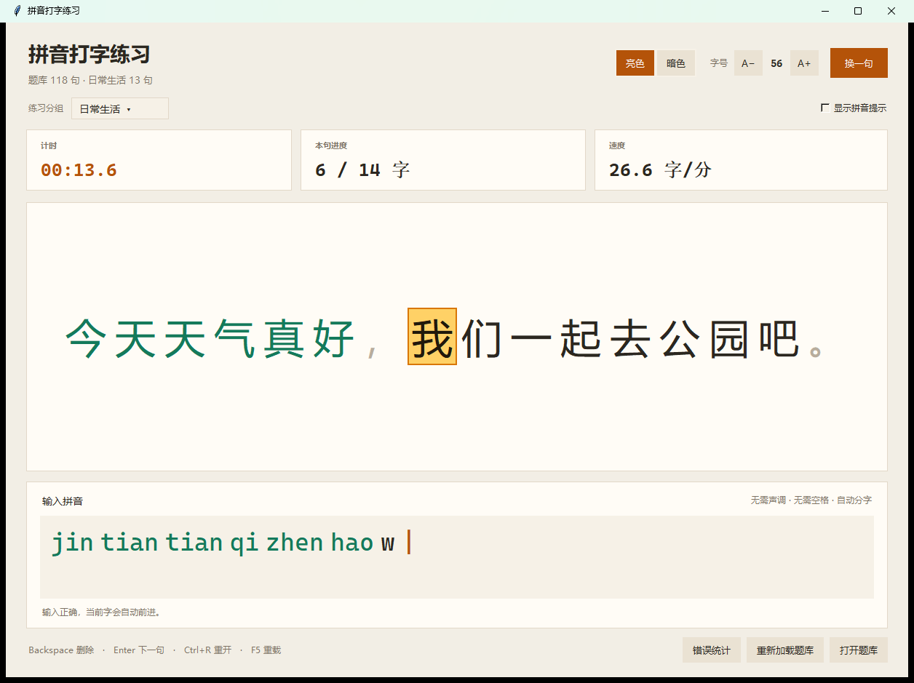
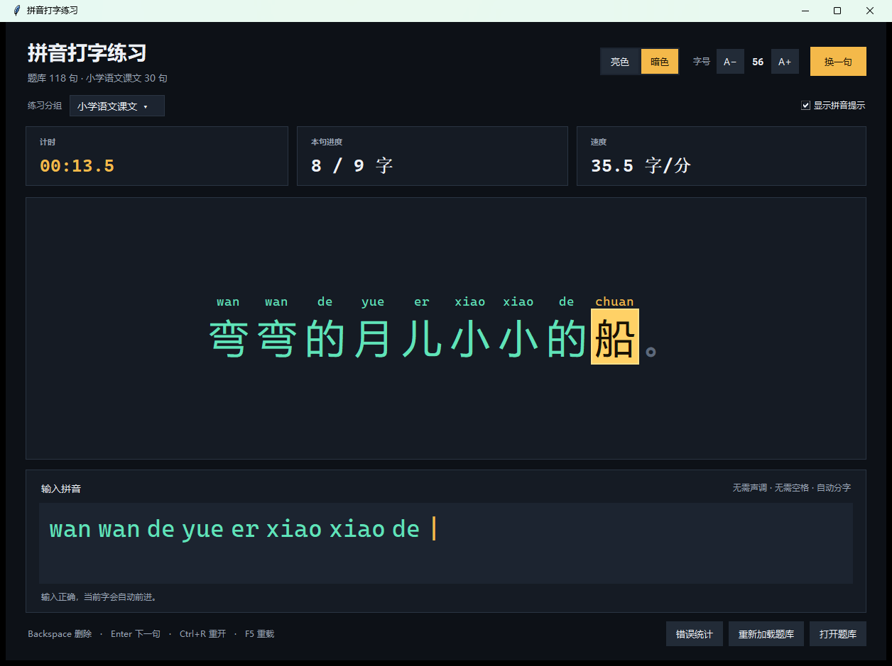
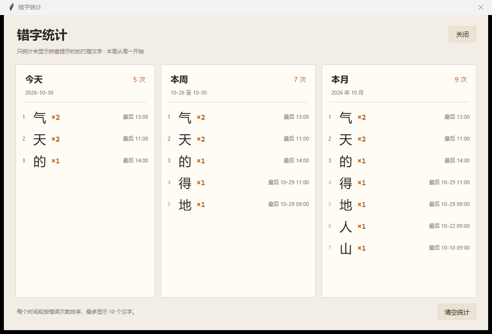

# 拼音打字练习

一个用 Python + Tkinter 编写的整句拼音打字练习工具。上方显示中文句子，当前正在输入的字会高亮；下方输入整句拼音，完成后自动显示用时和速度。支持分组练习、可选拼音提示、错字统计、亮色/暗色主题和可调字号。

| 亮色主题 | 暗色主题（开启拼音提示） |
|---|---|
|  |  |



## 功能

- 整句连续输入拼音，不需要逐字回车。
- **不用输入空格**；输入区会按目标字音自动分字，在拼音之间留出小间距。
- 当前字高亮，已完成的字变绿，标点自动跳过。
- 输错时输入框变红，按 Backspace 修改即可。
- 第一次输入字母时开始计时，整句完成时停止。
- 实时显示进度和速度（字/分），完成后按 Enter 进入下一句。
- 练习分组下拉框，可只练某一个分组，也可以练全部分组。
- 可选“显示拼音提示”，在汉字上方显示正确拼音。
- 未开启拼音提示时自动记录打错的汉字和时间，按今天、本周、本月统计高频错字。
- 118 句内置练习，覆盖日常生活、自然、学习工作、旅行美食、成语诗词、绕口令、生活感悟和小学语文课文。
- 亮色 / 暗色两种配色，设置会自动保存。
- 字号可在 32–96 之间调整，默认 56；句子过长时句子区可滚动，不挤压输入区。
- 拼音按词组上下文生成，能正确处理“银行、音乐、重庆、山重水复”等多音字。

## 运行环境

本项目使用本机 `C:\py` 下的 Python 环境：

```text
C:\py\.pixi\envs\default\python.exe
Python 3.14.7
Tk 8.6
pypinyin 0.55.0
```

`pypinyin` 已经装入 `C:\py` 环境。若需要重新安装：

```powershell
cd C:\py
pixi add pypinyin
```

## 启动

双击项目根目录的 `run.bat` 即可启动（无控制台窗口）。

调试时使用 `run-debug.bat`，可以查看 Python 控制台错误。

也可以直接运行：

```powershell
& "C:\py\.pixi\envs\default\python.exe" .\main.py
```

## 玩法

1. 启动后用英文输入状态直接输入当前句子的拼音。
2. **不需要输入声调**，例如“你好”输入 `ni hao` 或 `nihao`。
3. **不需要输入空格**。下方会自动分成 `ni hao` 这样的字音组，方便区分。
4. 中文标点不用输入，输入到前一个字后会自动跳过。
5. `ü` 可以输入为 `v`，例如“绿色”输入 `lvse`。
6. 当前字显示为亮黄色底块；输错时下方状态会提示，按 Backspace 删除错误字母。
7. 整句输入完成后计时停止，按 Enter 开始下一句。

> 如果输入中文没有反应，请把输入法切换到英文模式。

## 分组练习

顶部“练习分组”下拉框支持：

- `全部句子`：从整个题库中随机练习。
- 任意一个分组：只从该分组中随机练习，例如只练“日常生活”或“小学语文课文”。

切换分组会立即开始该分组的新句子，所选分组会保存到 `.settings.json`，下次启动继续使用。

当前题库共 **118 句、9 个分组**：

| 分组 | 句数 |
|---|---:|
| 日常生活 | 13 |
| 自然四季 | 13 |
| 学习与工作 | 13 |
| 旅行与美食 | 13 |
| 成语与诗词 | 12 |
| 绕口令与趣味 | 8 |
| 生活感悟 | 10 |
| 更多练习 | 6 |
| 小学语文课文 | 30 |

## 拼音提示与错字统计

### 显示拼音提示

勾选顶部的“显示拼音提示”后，每个汉字上方会显示正确的无声调拼音：

- 当前字的拼音用强调色显示。
- 已完成的字拼音变绿，未完成的字为灰色。
- 标点上方留空，不参与输入。

开启拼音提示时，**错字统计会暂停记录**，避免照抄提示时产生无意义的统计。

### 错字统计

关闭拼音提示后：

- 当输入到某个字时打错拼音，会记录当前汉字、目标拼音、已输入内容和时间。
- 同一次错误不会因为继续按键而重复记录；退格改正后再次打错会重新记录。
- 点击底部“错误统计”按钮，可查看今天、本周、本月的高频错字。
- 每个时间段显示错误次数和最后一次出错时间；按错误次数从高到低排列，最多显示 10 个汉字。
- “本周”从周一开始。
- 统计窗口中可以点击“清空统计”清除全部记录。

统计只保存在本机项目目录的 `.stats.json` 中，不会上传到任何地方。该文件已被 Git 忽略。

## 字号与主题

- 点击右上角 `A−` / `A+` 调整字号，范围 32–96，默认 56。
- 也可以按 `Ctrl + 鼠标滚轮`，或 `Ctrl+=` / `Ctrl+-`。
- 点击“亮色”/“暗色”切换配色，选择会保存在 `.settings.json` 中，下次启动继续使用。
- 拼音输入区字号会跟随中文字号自动缩放。
- 大字号或开启拼音提示后，如果句子超过卡片高度，句子区会出现细滚动条；输入区始终保留。

## 编辑题库

题库文件是项目根目录的 `sentences.txt`，UTF-8 编码，一行一句：

```text
# ---------- 日常生活 ----------
今天天气真好，我们一起去公园散步吧。
# [小学语文课文]
弯弯的月儿小小的船。
```

分组标题支持两种写法：

- `# ---------- 分组名 ----------`
- `# [分组名]`

其他以 `#` 开头的行是普通注释，空行会被忽略。添加或修改后，回到应用中点击“重新加载题库”（或按 `F5`）。

- 没有分组标题的句子会进入“未分组”。
- 重复句子和无法解析的行会被跳过，并在加载时提示。
- 建议一句一行，使用正常中文标点，pypinyin 能更准确地进行词组切分。
- 点击“打开题库”可以直接编辑。

## 快捷键

| 按键 | 功能 |
|---|---|
| `Backspace` | 删除错误字母 |
| `Enter` | 完成后进入下一句 |
| `Ctrl + R` | 重开当前句并清零计时 |
| `F5` | 重新加载题库 |
| `Ctrl + 鼠标滚轮` | 调整字号 |
| `Ctrl + =` / `Ctrl + -` | 放大 / 缩小字号 |

## 项目结构

```text
pinyin-typing/
├─ main.py              # 入口、DPI 和错误提示
├─ app.py               # Tkinter 界面、分组、提示、主题、计时器
├─ trainer.py           # 拼音生成、输入判定、分组解析、自动分字
├─ stats.py             # 错字记录与今天/本周/本月聚合
├─ sentences.txt        # 118 句、9 个分组的题库
├─ docs/                # 界面与统计窗口预览
├─ tests/
│  ├─ test_trainer.py   # 拼音、分组、自动分字测试
│  └─ test_stats.py     # 错字统计与时间范围测试
├─ run.bat              # 正常启动（pythonw）
├─ run-debug.bat        # 调试启动（显示控制台）
├─ requirements.txt
└─ .gitignore
```

`.settings.json` 和 `.stats.json` 是运行后自动生成的本地文件，已被 Git 忽略。

## 测试

```powershell
cd C:\Users\kaiwen\Documents\deepseek-harness\default-workspace\pinyin-typing
& "C:\py\.pixi\envs\default\python.exe" -m unittest discover -s tests -v
```

当前共 34 个测试，覆盖拼音解析、多音字、标点跳过、输入规范化、自动分字、分组解析、错字统计时间范围、计时格式、随机不重复和题库加载。
